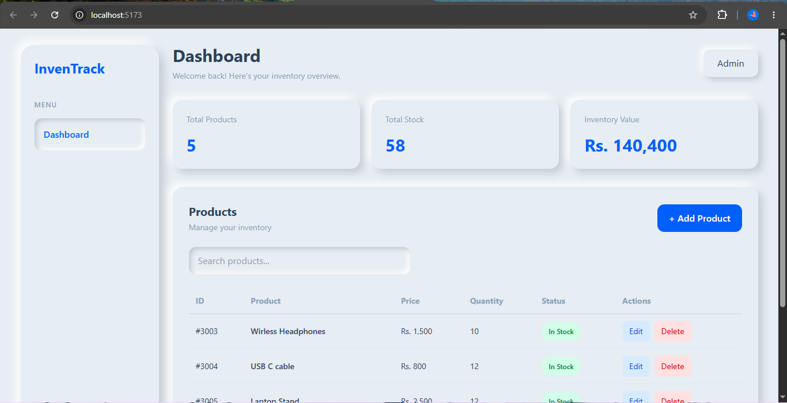

# InvenTrack – Inventory Management System

A full-stack Inventory Management System built to manage products, track stock, and calculate inventory value.

## Features

- Add, view, update, and delete products (CRUD)
- Search products by name
- Track total products and available stock
- Calculate total inventory value
- Stock status indicators:
  - In Stock
  - Low Stock
  - Out of Stock
- Responsive dashboard with Neumorphism UI
- Backend data validation

## Technologies Used

### Frontend
- React.js
- Tailwind CSS
- JavaScript

### Backend
- C#
- ASP.NET Core Web API
- Entity Framework Core

### Database
- Microsoft SQL Server Express

## Project Structure

```text
InvenTrack/
├── InventoryManagementAPI/
│   ├── Controllers/
│   ├── Models/
│   ├── Data/
│   └── Program.cs
│
├── InventoryManagementFrontend/
│   ├── src/
│   ├── public/
│   └── package.json
│
└── .gitignore
```

## Setup Instructions

### 1. Clone the repository

```bash
git clone https://github.com/areeza-arshad/InvenTrack-Inventory-Management-System.git
```

### 2. Backend Setup

Open the backend folder:

```bash
cd InventoryManagementAPI
```

Update the SQL Server connection string in `appsettings.json` according to your local SQL Server instance.

Run database migrations:

```bash
dotnet ef database update
```

Start the API:

```bash
dotnet run
```

### 3. Frontend Setup

Open another terminal:

```bash
cd InventoryManagementFrontend
npm install
npm run dev
```

Open the local URL displayed by Vite.

## Project Screenshot



## Author

**Areeza Arshad**

GitHub: https://github.com/areeza-arshad
